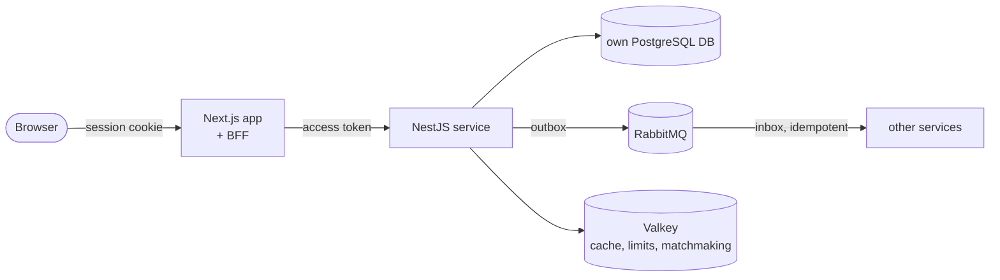
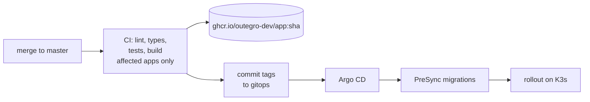

<div align="center">

<a href="https://outegro.dev"></a>

# outegro-dev / platform

**The monorepo behind [outegro.dev](https://outegro.dev): six web apps, five services and the shared packages that tie them together.**

[](https://github.com/outegro-dev/platform/actions/workflows/ci.yml)
[](https://outegro.dev)


</div>

Every app in this repository runs in production. Merging to `master` builds only the affected apps, pushes images to GHCR and hands the new tags to [outegro-dev/gitops](https://github.com/outegro-dev/gitops), where Argo CD rolls them out.

## Apps

| App | Live | Port | What it is |
|---|---|---|---|
| [`landing-web`](apps/landing-web) | [outegro.dev](https://outegro.dev) | 3000 | Portfolio landing in a zine style, EN/RU, `/stack`, design-system gallery |
| [`id-web`](apps/id-web) | [id.outegro.dev](https://id.outegro.dev) | 3002 | Account: sign-in by email code, passkeys, Google; sessions, security, notifications |
| [`pay-web`](apps/pay-web) | [pay.outegro.dev](https://pay.outegro.dev) | 3003 | Catalog, checkout, return page, subscriptions, purchases |
| [`admin-web`](apps/admin-web) | admin.outegro.dev | 3004 | Operator console: users, roles, grants, audit, payments, education, Grafana SSO |
| [`battleship-web`](apps/battleship-web) | [battleship.outegro.dev](https://battleship.outegro.dev) | 3005 | Game client: placement, live match, replays, leaderboard, profile, shop |
| [`edu-web`](apps/edu-web) | [edu.outegro.dev](https://edu.outegro.dev) | 3006 | Book reader with quizzes, event-loop simulator, SQL sandbox in a Web Worker, AI helper |

| Service | Port | Responsibility |
|---|---|---|
| [`auth-backend`](apps/auth-backend) | 4001 | Identity, SSO (PKCE), ES256 JWT + JWKS, passkeys, Google, sessions, roles, audit |
| [`notifications-backend`](apps/notifications-backend) | 4002 | Email (Resend) and Telegram, versioned EN/RU templates, delivery from events |
| [`payments-backend`](apps/payments-backend) | 4003 | Checkout, webhooks, reconciliation, subscriptions, refunds, entitlement grants |
| [`battleship-backend`](apps/battleship-backend) | 4004 | Server-authoritative game over WebSockets, matchmaking, bots, Elo, forfeits |
| [`edu-backend`](apps/edu-backend) | 4005 | Books as typed documents, access rules, server-graded exercises, AI helper with quotas |

## Shared packages

| Package | |
|---|---|
| [`ui`](packages/ui) | Design system: tokens, zine themes, components shared by every web app |
| [`i18n`](packages/i18n) | EN/RU messages and locale handling |
| [`bff`](packages/bff) | Backend-for-frontend helpers: SSO sign-in, session cookies, tokens stay on the server |
| [`contracts`](packages/contracts) | Typed API and event contracts shared by clients and services |
| [`db`](packages/db) | Drizzle helpers, outbox / inbox |
| [`nest-common`](packages/nest-common) | Config, auth guards, logging, metrics, errors, messaging, Valkey, health checks for every service |
| [`battleship-engine`](packages/battleship-engine) | Rules, match state machine, four bot strategies, Elo |
| [`edu-engine`](packages/edu-engine) | Exercise rules shared by the reader and the server |
| [`system-tests`](packages/system-tests) | Cross-service tests against real infrastructure |

## Architecture



- **Tokens never reach the browser.** Each web app signs in through `id.outegro.dev` with PKCE; the BFF keeps tokens server-side.
- **One database per service.** Services never read each other's tables; they exchange versioned events through a transactional outbox and an idempotent inbox, with TTL-queue retries and dead-letter queues.
- **Contracts first.** Request bodies, responses and events are Zod schemas in `@outegro/contracts`, used for validation and OpenAPI alike.

The full specification, contracts and ADRs live in [`docs/`](docs) (in Russian).

## Run locally

Requires Node.js 24+, pnpm 12.3.4 (`corepack enable`) and Docker.

```sh
pnpm install --frozen-lockfile
pnpm infra:up     # PostgreSQL 18, Valkey 9, RabbitMQ 4, Mailpit
pnpm env:local    # generate local .env files and secrets
pnpm dev
```

- Landing: http://localhost:3000 · design-system gallery: http://localhost:3000/design-system
- Mail: http://localhost:8025 · RabbitMQ: http://localhost:15672 (`outegro` / `outegro`)
- Health probes: `/health` and `/health/deep`
- Migrations: `node --env-file=.env dist/db/migrate.js` inside each `*-backend` after `pnpm build`

## Checks

| Command | |
|---|---|
| `pnpm lint` | Biome |
| `pnpm typecheck` | TypeScript across the monorepo |
| `pnpm test` | Unit + integration (Testcontainers, needs Docker) |
| `pnpm test:e2e` | Playwright on Chromium, Firefox and WebKit, with axe checks |
| `pnpm verify` | All of the above |

Before the first e2e run: `pnpm exec playwright install chromium firefox webkit`.

## Delivery



Documentation-only changes skip CI builds. Rollback is a `git revert` of the tag commit in [gitops](https://github.com/outegro-dev/gitops).

## Documentation (RU)

- [Start here](docs/00-start-here/README.md) · [Handoff: current state](docs/00-start-here/handoff.md) · [Next steps](docs/00-start-here/next-steps.md)
- [Specification](docs/01-specification/README.md) · [Contracts](docs/02-contracts/README.md) · [Decisions & ADRs](docs/03-decisions/README.md)
- [Delivery plan](docs/04-delivery/README.md) · [Test strategy](docs/05-quality/README.md) · [Runbooks](docs/06-operations/README.md) · [Evidence](docs/09-evidence/README.md)
- Design, motion, language and CSP decisions: [DESIGN.md](DESIGN.md) · design system: [packages/ui](packages/ui/README.md)

---

<sub>Built and operated by <a href="https://github.com/coping-barrel">Nick Lukashik</a> · <a href="https://outegro.dev">outegro.dev</a></sub>
